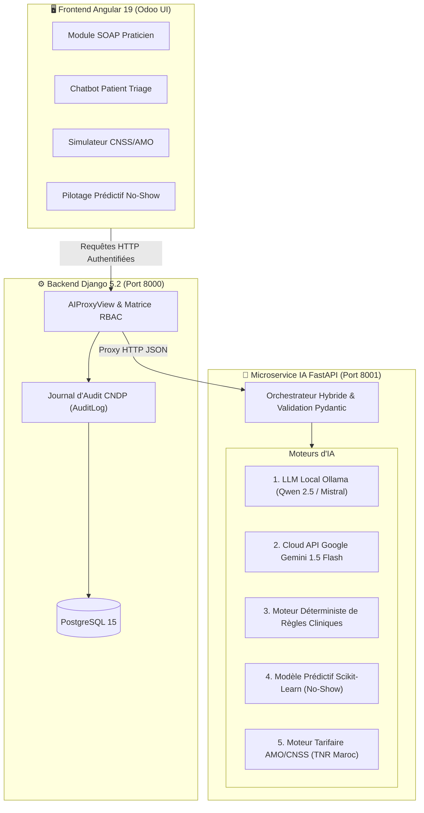
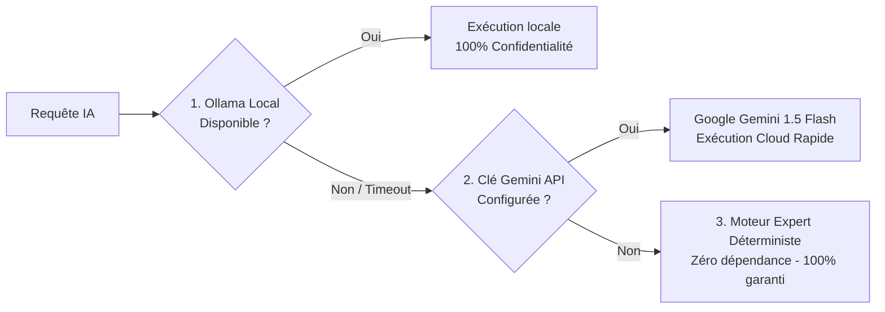

# 🧠 MediCAB — Rapport Détaillé du Sous-Système d'Intelligence Artificielle

> **Projet :** Système Intelligent de Gestion de Cabinet Médical (MediCAB)  
> **Auteur :** Équipe Projet MediCAB  
> **Technologies IA :** FastAPI, Ollama (Qwen 2.5 / Llama 3), Google Gemini API, Scikit-Learn (Predictive ML), NLP  
> **Conformité :** Déontologie médicale marocaine, CNDP (Loi 09-08), Tarification Nationale de Référence (TNR / AMO)

---

## 1. Vision & Objectifs de l'IA dans MediCAB

L'intégration de l'Intelligence Artificielle dans **MediCAB** n'est pas un simple gadget conversationnel ; elle répond à des défis concrets de gestion médicale au Maroc :

1. **Allègement de la charge administrative des praticiens** : Automatiser la saisie des comptes-rendus de consultation au format standardisé international **SOAP**.
2. **Fluidification du parcours patient & triage intelligent** : Évaluer l'urgence des symptômes avant la venue au cabinet sans enfreindre la déontologie médicale.
3. **Optimisation logistique & financière (Zéro No-Show)** : Prédire les absences aux rendez-vous via du Machine Learning pour maximiser l'occupation des salles de consultation.
4. **Transparence financière pour le citoyen** : Calculer instantanément les montants pris en charge par l'**AMO / CNSS** et le ticket modérateur selon la législation marocaine.
5. **Résilience et accessibilité multi-environnements** : Fonctionner aussi bien sur des PC d'entrée de gamme sans carte graphique dédiée (via Gemini API) que sur des serveurs sécurisés locaux (via Ollama).

---

## 2. Architecture Technique & Pipeline de Données



### Justification du choix de microservice découplé (FastAPI)
* **Performances asynchrones** : FastAPI (`uvicorn`) traite les requêtes NLP sans bloquer le thread principal Django dédié aux transactions de base de données.
* **Typage strict Pydantic** : Chaque entrée/sortie IA est validée au runtime (`ConsultationDraftRequest`, `TriageResponse`, `NoShowRequest`).
* **Isolation environnementale** : Permet de conteneuriser le service d'IA indépendamment du backend métier.

---

## 3. Les 4 Piliers Fonctionnels de l'IA

---

### 🩺 Pilier 1 : Assistant de Consultation Clinique (Copilot SOAP)

#### Rôle & Défi Métier
Le médecin saisit souvent des notes rapides ou sténographiques (*« fébrile 48h, toux sèche, rhinite, TA 12/8 »*). L'IA transforme cette saisie brute en un compte-rendu médical officiel structuré selon la méthodologie **SOAP** (norme internationale) :
* **S (Subjectif)** : Ce que le patient rapporte (anamnèse, symptômes, motif).
* **O (Objectif)** : Constantes physiques mesurées (Tension, Température, examens cliniques).
* **A (Analyse / Assessment)** : Hypothèse diagnostique principale.
* **P (Plan)** : Conduite à tenir, examens complémentaires et traitement prescrit.

#### Automatisation End-to-End
Lors du clic sur **« ✓ Transférer vers la Consultation »** :
1. Une consultation est créée dans Django/PostgreSQL.
2. Si l'IA a suggéré une ordonnance (`prescription_suggeree`), une **Ordonnance officielle** liée à cette consultation est automatiquement générée.
3. Chaque médicament (molécule, posologie, durée) est instantanément ventilé dans le module **`lignes-prescription`**.

#### Exemple de Payload
```json
// POST /api/ai/draft-consultation
{
  "patient_name": "Salma Benali",
  "age": 29,
  "motif": "Syndrome fébrile et toux",
  "notes_brutes": "Patiente fébrile depuis 48h, toux sèche, rhinite claire, céphalées modérées.",
  "tension": "12/8",
  "temperature": 38.2
}
```

---

### 💬 Pilier 2 : Chatbot Patient, Triage & Prise de Rendez-vous

#### Rôle & Démarche Éthique
Le chatbot dialogue avec le patient avant sa venue pour orienter sa demande. 

> [!IMPORTANT]
> **Conformité Déontologique & CNDP :**  
> L'IA ne pose **jamais** de diagnostic certain. Elle formule uniquement des **hypothèses d'orientation** et affiche un avertissement obligatoire :  
> *« Cette analyse est une assistance informative d'orientation réalisée par une IA. Elle ne remplace en aucun cas l'examen clinique et le diagnostic du médecin. »*

#### Algorithme de Gravité (Triage à 3 Niveaux)
1. **Urgent (Rouge)** : Détection de signaux d'alerte vitale (douleur thoracique, suspicion AVC, détresse respiratoire, hémorragie).  
   *Action :* Blocage de la prise de RDV en ligne, alerte immédiate et affichage des numéros d'urgence marocains (**141 SAMU, 150 Protection Civile**).
2. **Modéré (Jaune)** : Symptômes aigus non vitaux (fièvre, toux persistante, coliques).  
   *Action :* Proposition d'un rendez-vous prioritaire sous 24 à 48 heures avec un médecin généraliste.
3. **Faible (Vert)** : Soins de routine, contrôle, renouvellement.  
   *Action :* Réservation standard dans l'agenda.

---

### 💳 Pilier 3 : Simulateur CNSS / AMO (Tarification Marocaine)

#### Rôle & Règles Réglementaires
Ce moteur résout la complexité de calcul du remboursement des soins de santé au Maroc régis par l'ANAM et la CNSS.

#### Formules de Calcul Appliquées
$$\text{Remboursement CNSS} = \text{TNR} \times \text{Taux}$$
$$\text{Ticket Modérateur} = \text{TNR} - \text{Remboursement CNSS}$$
$$\text{Dépassement d'honoraires} = \max(0, \text{Montant Facturé} - \text{TNR})$$
$$\text{Reste à Charge Patient} = \text{Ticket Modérateur} + \text{Dépassement d'honoraires}$$

* **TNR (Tarif National de Référence)** :
  * Consultation Généraliste : **150 DH**
  * Consultation Spécialiste : **250 DH**
  * Acte Technique : **200 DH**
* **Taux de prise en charge** :
  * Régime général AMO : **70%** (soit 105 DH remboursés sur 150 DH).
  * Affection de Longue Durée (ALD reconnue) : **100%** (ticket modérateur à 0 DH).
* **Export Officiel** : Génération et impression immédiate d'une **Feuille de Soins AMO normalisée**.

---

### 📊 Pilier 4 : Prédiction du Risque de No-Show (Scikit-Learn)

#### Problématique
Dans les cabinets médicaux, le taux de rendez-vous non honorés (*No-Show*) oscille entre 15% et 30%, causant des pertes financières directes et désorganisant les plannings.

#### Variables d'Entrée & Poids du Modèle
L'algorithme de scoring probabiliste analyse :
1. **Délai de prise de RDV** ($\Delta t$ en jours) : Plus le rendez-vous est pris loin dans le temps, plus le risque d'oubli s'élève ($+3\%$ par jour jusqu'à un plafond).
2. **Historique des absences du patient** : Facteur de récidive statistique le plus discriminant ($+15\%$ par absence antérieure non justifiée).
3. **Canal de rappel SMS / WhatsApp** : L'absence de rappel augmente le risque de $+20\%$.
4. **Effet du jour de la semaine** : Sur-risque observé statistiquement les lundis et vendredis ($+5\%$).

#### Décision Opérationnelle pour la Secrétaire
* **Risque Faible (< 25%)** : Notification automatique standard par e-mail.
* **Risque Modéré (25% - 45%)** : SMS de rappel envoyé 24h avant avec lien d'annulation rapide.
* **Risque Élevé (> 45%)** : Appel téléphonique de confirmation obligatoire et possibilité d'ouvrir un **sur-créneau (overbooking maîtrisé)**.

---

## 4. Architecture Hybride & Stratégie de Résilience

Pour garantir que MediCAB fonctionne en toutes circonstances (PC modeste d'un cabinet sans GPU, panne internet, ou contrainte de confidentialité locale stricte), un système de cascade à 3 niveaux a été implémenté :



1. **Niveau 1 — Ollama (Local & Souverain)** :
   * Modèle : `qwen2.5:3b` ou `mistral:7b`.
   * Avantage : Aucune fuite de données hors du cabinet (conformité totale CNDP).
2. **Niveau 2 — Google Gemini API (Cloud Intelligent)** :
   * Modèle : `gemini-1.5-flash`.
   * Avantage : Ne nécessite aucune ressource machine, réponse en < 800ms, idéal pour les partenaires ne disposant pas de PC puissants.
3. **Niveau 3 — Moteur de Règles Cliniques Déterministe (Fallback ultime)** :
   * Analyse sémantique par expressions régulières et ontologies médicales pré-compilées.
   * Avantage : **Ne plante jamais**, fonctionne même hors ligne sans modèle LLM installé.

---

## 5. Traçabilité, Audit & Conformité CNDP

Toute interaction avec l'IA fait l'objet d'un enregistrement dans le journal d'audit Django (`accounts.AuditLog`) avec les codes d'action dédiés :
* `AI_GENERATE` : Génération de compte-rendu SOAP ou ordonnance.
* `AI_TRIAGE` : Évaluation de symptômes via le chatbot.
* `AI_CNSS` : Simulation financière de remboursement.
* `AI_PREDICT` : Prédiction de probabilité de No-Show.

Chaque entrée consigne l'horodatage précis, l'utilisateur connecté (ou session patient), le module concerné et le détail de l'opération, garantissant une **traçabilité médico-légale irréprochable**.

---

## 6. Synthèse des Endpoints de l'API IA

| Méthode | Route | Rôle Métier | Entrées Principales | Sorties |
|---|---|---|---|---|
| `POST` | `/api/ai/draft-consultation` | Génération SOAP & Ordonnance | `notes_brutes`, `motif`, `tension`, `temperature` | SOAP (S,O,A,P), Diagnostic, Médicaments |
| `POST` | `/api/ai/patient-triage` | Triage symptômes & Orientation | `message`, `patient_id` | Gravité, Hypothèses, Créneaux RDV, Alerte CNDP |
| `POST` | `/api/ai/cnss-calculator` | Calcul AMO / CNSS | `type_prestation`, `montant_facture`, `est_ald` | TNR, Remboursement, Ticket modérateur |
| `POST` | `/api/ai/predict-noshow` | Prédiction d'absence RDV | `delai_jours`, `historique_absences`, `rappel_sms` | Probabilité %, Niveau de risque, Action |
| `GET` | `/api/ai/health` | Diagnostic de santé & fallbacks | Aucun | Statut Ollama, Clé Gemini, Mode actif |
